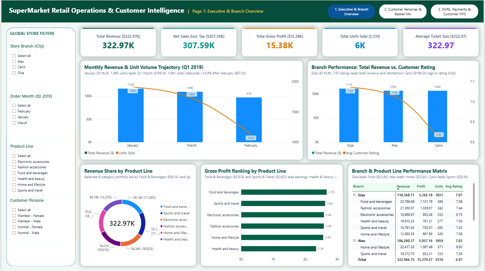
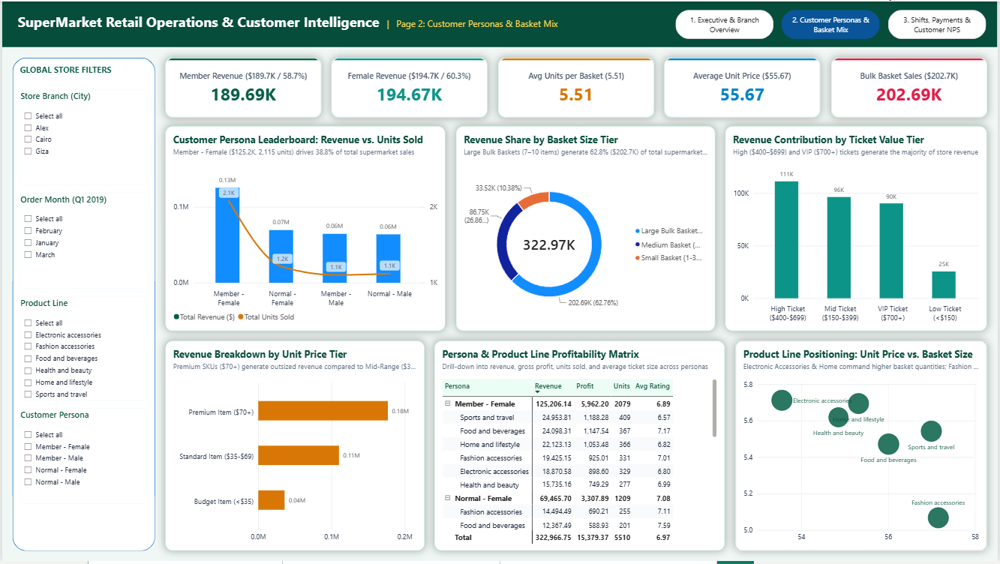
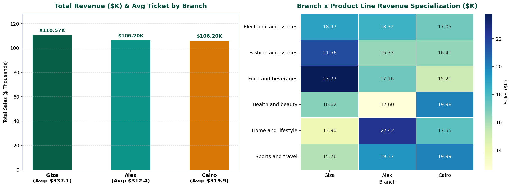
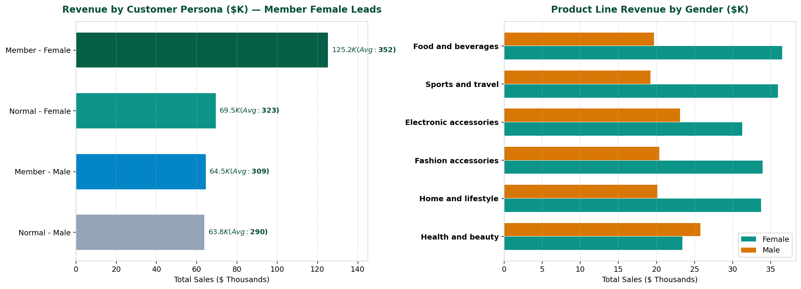
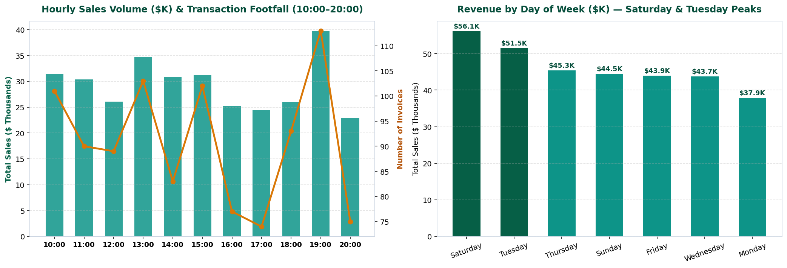
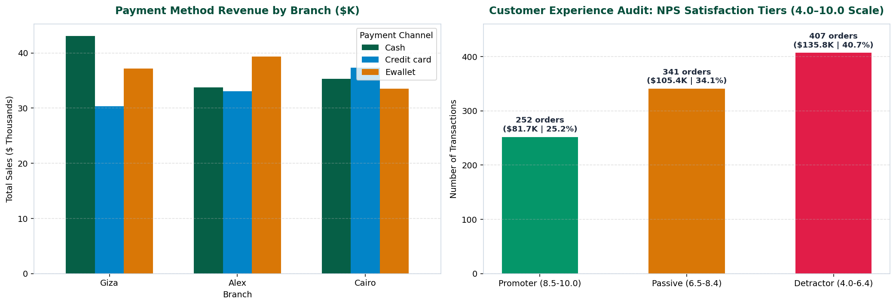

# 🛒 SuperMarket Q1 Retail Operations, Basket Economics & Customer Experience Audit


> **End-to-End Retail Analytics Portfolio Project:** Data Governance Remediation, 17-Column Python Feature Engineering Pipeline, SQLite Analytical Data Warehouse (6 Views), and Custom-Themed Executive Power BI Dashboard auditing **1,000 transactions ($322.97K revenue)** across three regional branches (**Alexandria**, **Cairo**, and **Giza**) in Q1 2019.

---

## 📌 Table of Contents
1. [Executive Summary & Business Problem](#-executive-summary--business-problem)
2. [Key Performance Indicators (Q1 2019 Benchmark)](#-key-performance-indicators-q1-2019-benchmark)
3. [Interactive Power BI Dashboard Preview](#-interactive-power-bi-dashboard-preview)
4. [Repository Architecture](#-repository-architecture)
5. [Data Governance & Feature Engineering Pipeline](#-data-governance--feature-engineering-pipeline)
6. [SQLite Analytical Warehouse](#-sqlite-analytical-warehouse)
7. [Key Analytical Insights & Python Visual Audit](#-key-analytical-insights--python-visual-audit)
8. [Strategic Recommendations](#-strategic-recommendations)
9. [How to Run & Reproduce](#-how-to-run--reproduce)

---

## 🎯 Executive Summary & Business Problem

During Q1 2019 (`2019-01-01` to `2019-03-30`), regional supermarket operations across **Alexandria (`Alex`)**, **Cairo**, and **Giza** generated **$322,966.75** in gross revenue across **1,000 invoices** and **5,510 units sold**. Because the retail chain operates under a **fixed gross margin structure of 4.7619%** (yielding **$15,379.37** in gross income), profitability cannot be expanded through category margin arbitrage alone—it is strictly a function of **transaction volume, basket size expansion, peak-hour throughput, and loyalty conversion**.

This project solves four critical operational challenges:
1. **Data Governance Remediation:** Audited and resolved a 100% systematic schema mismatch where Egyptian branch identifiers (`Alex`, `Cairo`, `Giza`) were paired with legacy Myanmar city strings (`Yangon`, `Mandalay`, `Naypyitaw`), preserving full lineage via `Legacy_City`.
2. **Basket & Persona Economics:** Quantified revenue concentration across customer segments (`Member` vs. `Normal` × `Gender`) and 6 core product lines to guide targeted cross-selling.
3. **Shift & Peak-Hour Capacity Planning:** Mapped hourly transaction velocity (`10:00` to `20:00`) and day-of-week demand curves to optimize POS staffing and restocking schedules.
4. **Customer Experience (NPS) & Payment Friction Audit:** Segmented customer ratings (`4.0` to `10.0`) into actionable NPS-style satisfaction tiers (`Promoter`, `Passive`, `Detractor`) and evaluated checkout payment preferences (`Cash`, `Ewallet`, `Credit card`).

---

## 📊 Key Performance Indicators (Q1 2019 Benchmark)

| Metric | Q1 2019 Performance | Operational Context |
| :--- | :--- | :--- |
| **Total Gross Revenue (`Sales`)** | **$322,966.75** | Includes 5% value-added tax ($15,379.37) |
| **Net Sales (`COGS`)** | **$307,587.38** | Excludes 5% tax across 1,000 validated invoices |
| **Total Gross Profit (`gross income`)** | **$15,379.37** | Fixed **4.7619%** gross margin across all 6 product lines |
| **Total Volume Sold (`Quantity`)** | **5,510 Units** | Average basket size of **5.51 units / invoice** |
| **Average Ticket Size** | **$322.97** | Median ticket: **$253.85** (Range: **$10.68 – $1,042.65**) |
| **Average Customer Rating** | **6.97 / 10.0** | **27.5% Promoters** (≥8.5) · **32.7% Passives** · **39.8% Detractors** (<6.5) |

---

## 🖥️ Interactive Power BI Dashboard Preview

The interactive Power BI report ([`04_PowerBI_Dashboard/SuperMarket_Analysis.pbix`](04_PowerBI_Dashboard/SuperMarket_Analysis.pbix)) is styled with a custom executive JSON theme ([`SuperMarket_Executive_Theme.json`](04_PowerBI_Dashboard/SuperMarket_Executive_Theme.json)) across three analytical views:

### 1. Executive Overview & Branch Performance


### 2. Customer Personas, Basket Economics & Product Mix


### 3. Operational Shifts, Hourly Traffic & Customer Experience (NPS)


---

## 📂 Repository Architecture

```text
SuperMarket-Q1-Retail-Operations-Audit/
│
├── 01_Data/
│   ├── SuperMarket Analysis.csv            # Raw dataset (1,000 rows x 17 columns)
│   └── Clean_SuperMarket.csv               # Cleaned & feature-engineered dataset (1,000 rows x 33 columns)
│
├── 02_SQL_Warehouse/
│   ├── SuperMarket_Analysis.db             # Production SQLite database (raw_invoices, clean_invoices + 6 Views)
│   └── SuperMarket_Analytical_Views.sql    # Standalone SQL DDL & analytical view definitions
│
├── 03_Python_Pipeline/
│   └── SuperMarket_Analysis.ipynb          # End-to-end ETL, statistical validation, SQL execution & visualizations
│
├── 04_PowerBI_Dashboard/
│   ├── SuperMarket_Analysis.pbix           # Interactive Executive Power BI Report
│   └── SuperMarket_Executive_Theme.json    # Custom executive color palette (#1E3A5F Navy, #0D9488 Teal, #D97706 Amber)
│
├── 05_Visuals/
│   ├── dashboard_preview1.png              # Power BI Dashboard Screenshot - View 1
│   ├── dashboard_preview2.png              # Power BI Dashboard Screenshot - View 2
│   ├── dashboard_preview3.png              # Power BI Dashboard Screenshot - View 3
│   ├── 01_Branch_Product_Performance.png   # Python Visual 1: Branch KPIs & Branch x Product Line Heatmap
│   ├── 02_Customer_Persona_Economics.png   # Python Visual 2: Customer Persona Leaderboard & Gender Split
│   ├── 03_Hourly_Daily_Traffic_Trends.png  # Python Visual 3: Hourly Sales/Footfall Curve & Day-of-Week Revenue
│   └── 04_Payment_Channels_NPS_Tiers.png   # Python Visual 4: Payment Channel Mix & NPS Satisfaction Tiers
│
├── .gitignore
└── README.md
```

---

## 🛠️ Data Governance & Feature Engineering Pipeline

### 1. Schema & Geographic Lineage Fix
An initial data quality audit revealed zero missing values or duplicate `Invoice ID` keys, alongside **100% mathematical reconciliation** (`COGS = Unit Price × Quantity`, `Tax 5% = 0.05 × COGS`, `Sales = COGS + Tax 5%` with `0.000000` floating-point variance). However, `Branch` and `City` exhibited a systematic geographic mismatch:
- `Alex` was mapped to `Yangon` (340 rows) → Remediated to **`Alexandria`**
- `Cairo` was mapped to `Mandalay` (332 rows) → Remediated to **`Cairo`**
- `Giza` was mapped to `Naypyitaw` (328 rows) → Remediated to **`Giza`**

The original city strings were preserved in `Legacy_City` to maintain complete audit lineage.

### 2. 17 Engineered Analytical Features (`Clean_SuperMarket.csv`)
To power granular slicing in SQLite and Power BI, the Python pipeline engineered 17 new attributes:
- **Temporal Dimensions:** `Order Date` (ISO `YYYY-MM-DD`), `Order Year`, `Order Month Num`, `Order Month` (`January`–`March`), `Day of Month`, `Day of Week`, `Day Type` (`Weekend (Fri-Sat)` vs. `Weekday (Sun-Thu)`), `Hour 24`, `Time 24H`, and `Store Shift`:
  - `Morning (10AM-12PM)`
  - `Afternoon Peak (12PM-4PM)`
  - `Evening (4PM-7PM)`
  - `Night Closing (7PM-9PM)`
- **Basket & Pricing Tiers:**
  - `Basket Size Tier`: `Small (1-3 Units)`, `Medium (4-6 Units)`, `Large (7-10 Units)`
  - `Ticket Value Tier`: `Low (<$150)`, `Medium ($150-$350)`, `High ($350-$600)`, `VIP (>$600)`
  - `Unit Price Tier`: `Budget (<$35)`, `Mid-Range ($35-$70)`, `Premium (>$70)`
- **Customer Experience & Behavioral Segmentation:**
  - `Satisfaction Tier`: `Promoter (8.5-10.0)`, `Passive (6.5-8.4)`, `Detractor (4.0-6.4)`
  - `Customer Persona`: Combined loyalty and demographic matrix (`Member - Female`, `Member - Male`, `Normal - Female`, `Normal - Male`)

---

## 🗄️ SQLite Analytical Warehouse

The processed dataset is persisted into `02_SQL_Warehouse/SuperMarket_Analysis.db` alongside six pre-built analytical views (see [`02_SQL_Warehouse/SuperMarket_Analytical_Views.sql`](02_SQL_Warehouse/SuperMarket_Analytical_Views.sql)):

| SQL View Name | Analytical Purpose |
| :--- | :--- |
| `vw_branch_executive_kpis` | Aggregates invoices, units, revenue, COGS, gross profit, average ticket, rating, and Promoter/Detractor share by branch. |
| `vw_product_line_performance` | Ranks the 6 product lines by revenue, gross income, unit velocity, average unit price, and female revenue share (%). |
| `vw_branch_product_matrix` | Cross-tabulates `Branch x Product line` revenue, unit volume, and localized customer ratings. |
| `vw_customer_persona_analytics` | Evaluates transaction count, total spend, average basket size, and rating across the 4 `Customer Persona` cohorts. |
| `vw_hourly_shift_operations` | Tracks hourly footfall (`10:00–20:00`), shift revenue contribution, and basket density across the store operating day. |
| `vw_payment_channel_insights` | Compares `Ewallet`, `Cash`, and `Credit card` adoption, average ticket size, and satisfaction across branches. |

---

## 📈 Key Analytical Insights & Python Visual Audit

### 1. Branch Efficiency & Category Specialization


| Branch (`City`) | Invoices | Units Sold | Total Revenue | Gross Profit | Avg Ticket | Avg Rating | Promoter % | Detractor % |
| :--- | :---: | :---: | :---: | :---: | :---: | :---: | :---: | :---: |
| **Giza** | 328 | 1,831 | **$110,568.71** | **$5,265.18** | **$337.10** | **7.07** | **30.49%** | **37.80%** |
| **Alexandria (`Alex`)** | 340 | **1,859** | $106,200.37 | $5,057.16 | $312.35 | 7.03 | 27.65% | 37.06% |
| **Cairo** | 332 | 1,820 | $106,197.67 | $5,057.03 | $319.87 | 6.82 | 24.40% | **44.58%** |

- **Giza Leads Profitability & Experience:** Despite handling the fewest invoices (328), **Giza** ranks #1 in total revenue (**$110.57K**), average ticket (**$337.10**), and customer satisfaction (**7.07/10**, with **30.49% Promoters**), propelled by dominant sales in **Food and beverages ($23.77K)** and **Fashion accessories ($21.56K)**.
- **Alexandria Drives Footfall & Home Demand:** **Alex** captures the highest transaction count (**340 invoices**, **1,859 units**) and dominates **Home and lifestyle ($22.42K — 41.6% above Giza)**.
- **Cairo Service Bottleneck:** **Cairo** matches Alex in revenue (**$106.20K**) and leads in **Sports and travel ($19.99K)** and **Health and beauty ($19.98K)**, but suffers from a **44.58% Detractor rate** (rating **6.82/10**).

---

### 2. Customer Persona Economics & Gender Category Split


| Customer Persona | Transactions | Total Units | Total Revenue | Revenue Share | Avg Ticket Size | Avg Rating |
| :--- | :---: | :---: | :---: | :---: | :---: | :---: |
| **Member - Female** | **356** | **1,976** | **$125,206.14** | **38.77%** | **$351.70** | 6.94 |
| **Normal - Female** | 215 | 1,193 | $74,421.73 | 23.04% | $346.15 | **7.01** |
| **Member - Male** | 209 | 1,102 | $64,488.62 | 19.97% | $308.56 | 6.96 |
| **Normal - Male** | 220 | 1,239 | $58,850.26 | 18.22% | $267.50 | 7.00 |

- **`Member - Female` Powerhouse:** Female loyalty members represent **35.6%** of transactions and generate **$125,206.14 (38.8% of total company revenue)** with a benchmark average ticket of **$351.70**.
- **Category Divergence by Gender:** Female shoppers drive ~64–66% of revenue in **Food & Beverages ($36.79K)**, **Fashion Accessories ($35.16K)**, **Sports & Travel ($35.92K)**, and **Home & Lifestyle ($34.99K)**. Conversely, **Male shoppers outspend Females in Health and Beauty ($25,775.01 vs. $23,418.73)**, making `Health & Beauty` the #1 male-skewed cross-sell anchor.

---

### 3. Hourly Footfall Curve, Shift Velocity & Monthly Seasonality


- **19:00 (7:00 PM) Evening Surge:** Store traffic and revenue peak sharply at **19:00** with **113 transactions** and **$39,699.51** in sales (**12.3%** of all daily revenue generated in a single hour).
- **14:00 (2:00 PM) High-Value Baskets:** The `Afternoon Peak (12PM-4PM)` shift generates the largest shift revenue (**$122,526.92 across 378 transactions**), with **14:00** recording the highest average ticket of the day (**$371.43**).
- **Weekly & Monthly Rhythm:** **Saturday ($56,120.81)** and **Tuesday ($51,482.25)** are the strongest revenue days. Monthly revenue dipped **-16.4% in February ($97,219.37)** due to fewer calendar days (28 days) and lower basket sizes (**5.29 units**) before rebounding **+12.6% in March ($109,455.51)**.

---

### 4. Payment Channel Mix & Customer Satisfaction (NPS Tiers)


- **Digital vs. Cash Regional Split:** Across the chain, **Ewallet (345 txns, $109.99K)** and **Cash (344 txns, $112.21K)** lead volume, while **Credit card (311 txns, $100.77K)** lags by ~10%. However, **Giza remains heavily Cash-reliant ($43,253.20 — 39.1% of branch sales)**, whereas **Alexandria** and **Cairo** favor **Ewallet**.
- **Satisfaction Distribution:** Nearly **40% of customers (398 transactions)** score their experience between `4.0` and `6.4` (`Detractor`), representing the single highest-leverage operational improvement area.

---

## 💡 Strategic Recommendations

1. **Resolve Cairo Service Friction (`Target: Cut Detractors from 44.6% to <35%`):**
   - Deploy dedicated express checkout lanes (`1–3 units`) and audit POS staffing in **Cairo** during the **13:00 (`6.46` rating)** and **18:00–19:00** rush windows.
2. **Launch Targeted Loyalty Enrollment for `Normal - Female` & `Normal - Male` Shoppers:**
   - Convert high-spending `Normal - Female` shoppers (**$346.15 avg ticket**) into loyalty members at checkout, and introduce bundled **Health & Beauty + Electronic Accessories** promotions tailored to `Male` shoppers to lift their average basket from **5.35 units** toward the female benchmark (**5.64 units**).
3. **Incentivize Ewallet & Credit Card Adoption in Giza:**
   - Introduce a **2% instant loyalty cashback or point multiplier** on `Ewallet` transactions above **$350** in Giza to reduce cash-handling overhead (**$43.25K cash volume**) and speed up checkout throughput.
4. **Replicate Alexandria's `Home & Lifestyle` Merchandising in Giza & Cairo:**
   - Audit shelf allocation and promotional bundles that enabled **Alexandria** to generate **$22.42K** in `Home and lifestyle` vs. **$15.54K** in Cairo and **$15.90K** in Giza.

---

## 🚀 How to Run & Reproduce

1. **Clone the Repository:**
   ```bash
   git clone https://github.com/beshomagdy2050/SuperMarket-Q1-Retail-Operations-Audit.git
   cd SuperMarket-Q1-Retail-Operations-Audit
   ```
2. **Run the Python Pipeline (`Jupyter Notebook`):**
   ```bash
   pip install pandas numpy matplotlib seaborn
   jupyter notebook 03_Python_Pipeline/SuperMarket_Analysis.ipynb
   ```
3. **Query the SQLite Warehouse:**
   - Open `02_SQL_Warehouse/SuperMarket_Analysis.db` in **DB Browser for SQLite**, **DBeaver**, or via Python `sqlite3`, or run the queries in `02_SQL_Warehouse/SuperMarket_Analytical_Views.sql`.
4. **Explore the Interactive Power BI Dashboard:**
   - Open `04_PowerBI_Dashboard/SuperMarket_Analysis.pbix` in **Microsoft Power BI Desktop**.
   - To apply or customize the executive visual theme in other reports, import `04_PowerBI_Dashboard/SuperMarket_Executive_Theme.json` via **View → Themes → Browse for themes**.
